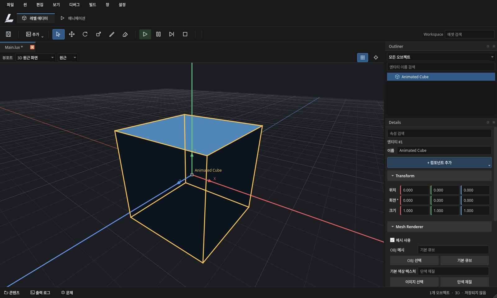
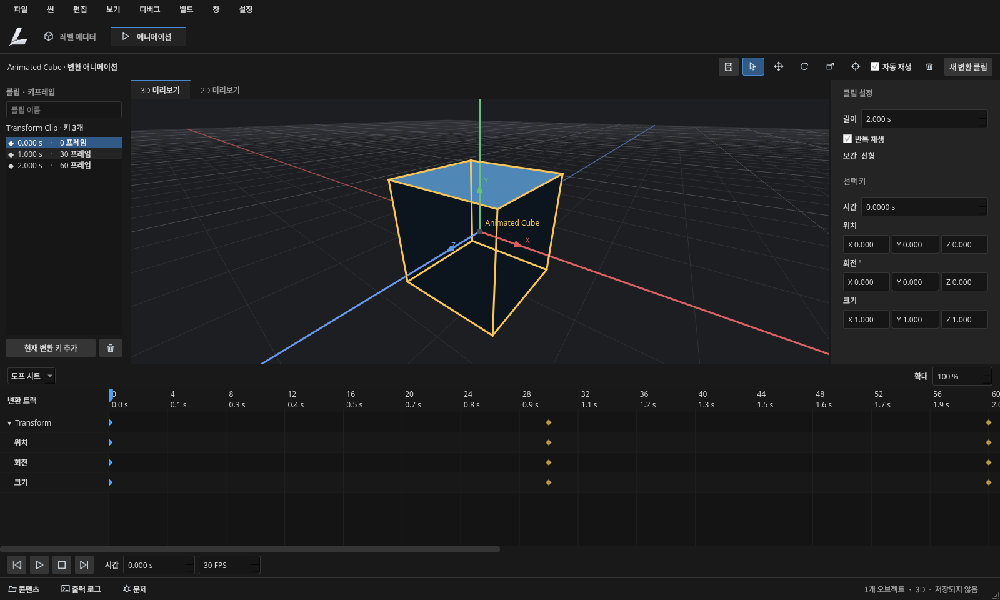

# 레벨·애니메이션 작업 공간

에디터는 Unreal의 [Level Editor](https://dev.epicgames.com/documentation/en-us/unreal-engine/unreal-editor-interface)와 [Sequencer](https://dev.epicgames.com/documentation/en-us/unreal-engine/sequencer-cinematic-editor-unreal-engine), Unity의 [Animation 창](https://docs.unity3d.com/Manual/AnimationEditorGuide.html)에서 공통적으로 쓰이는 뷰포트 중심 작업 흐름을 기준으로 구성했다. 각 제품의 기능 전체를 구현했다는 의미는 아니다.

## 레벨 편집

- 상단에서 레벨 에디터와 애니메이션 작업 공간을 전환한다.
- 중앙은 씬 문서 탭과 2D/3D 뷰포트다. 오른쪽은 Outliner와 Details다.
- 추가 메뉴에서 스프라이트, 메시, 타일맵, 카메라를 생성한다.
- Details는 해당 오브젝트에 연결된 컴포넌트만 표시한다. 컴포넌트 섹션을 접거나 속성 이름으로 검색할 수 있다. 추가 메뉴로 지원하는 컴포넌트를 연결한다.
- Transform의 X/Y/Z 필드를 한 행에 표시하고 축별 색을 사용한다. 카메라의 투영·기본 카메라·시야각·직교 크기를 편집할 수 있다. 기본 카메라를 지정하면 다른 카메라의 기본 지정이 해제된다. 변경은 Undo/Redo 및 씬 저장에 포함된다.
- 하단 콘텐츠 버튼 또는 Ctrl+Space로 Content Browser를 펼친다. 폴더 트리·경로·검색·종류 필터·격자/목록 보기를 제공한다. 출력 로그와 문제 패널도 같은 하단 영역을 사용한다.
- Place Actors, 보조 2D 뷰, 디버거는 창 메뉴에서 열 수 있다. 기본 화면에 모두 펼치지 않는다.
- 기존 배치 데이터와 새 배치 데이터는 버전을 구분한다. 창 메뉴의 기본 배치 복원으로 새 기본 배치로 돌아간다.

## 3D 조작과 격자

원근·정면·오른쪽·상단 프리셋을 제공한다. 키패드 1/3/7/5로도 전환한다. F는 선택 항목, Home은 전체 씬을 프레이밍한다. 이동·회전·크기 도구의 축 기즈모와 X/Y/Z 축 잠금을 지원한다. 격자 표시는 뷰포트 상단에서, 스냅은 보기 메뉴에서 전환한다.

격자는 카메라의 확대 비율과 포커스를 따라 간격과 범위를 계산한다. 2D의 고정 ±10000 범위 제한을 없앴고, 3D 격자 선분은 뷰 프러스텀에 잘라 투영한다. 원점에서 먼 씬, 극단적인 확대·축소, 프리셋 전환, HiDPI에서 격자와 선택·드래그 좌표의 일관성을 회귀 검사한다.

## 애니메이션

애니메이션은 하단의 작은 속성 패널이 아닌 중앙 전용 작업 공간이다. 클립/키 목록, 독립 프리뷰, 클립/선택 키 Details, 도프 시트와 재생 컨트롤을 제공한다. 시간 눈금과 재생 헤드, 트랙 펼침/접기, 키 선택·시간 드래그·삭제·값 편집, 확대·스크롤, 위치 곡선 표시를 지원한다.

현재 엔진은 오브젝트별 Transform 클립과 선형 보간을 지원한다. 키 하나는 위치·회전·크기를 함께 저장한다. 스켈레톤, 스프라이트 시트, 독립 채널 보간, 상태 머신은 아직 구현하지 않았고 인터페이스에서도 지원하는 것처럼 표시하지 않는다. 상세 사용법과 제한은 [AnimationWorkspace.md](AnimationWorkspace.md)에 기록했다.

## 브랜딩과 검증

상단 로고와 기본 창 아이콘은 원본 `Engine/Resources/Branding/dark.png`, `light.png`를 사용한다. 기존 루트 Assets에서 모듈 리소스 구조로 옮긴 파일이다. 파일을 새로 그리거나 원본 이미지를 변경하지 않았다.

`Editor_workspace_layout`은 기본 패널 배치, 접이식 콘텐츠, 폴더 탐색, Details 검색, 카메라 편집과 Undo, 애니메이션 전환·복원 및 960×600 최소 화면의 숫자 필드 크기를 검사한다. `Editor_animation_workspace`, `Editor_animation_timeline`, `Editor_viewport_foundation`은 각 편집 동작을 별도로 검사한다. 실제 GPU 및 다른 운영체제 검증 범위는 [RuntimeFoundationValidation.md](RuntimeFoundationValidation.md)를 확인한다.

## 실제 실행 화면

회귀 테스트의 예제 씬을 실제 NVIDIA GPU와 Qt 에디터로 실행해 캡처했다.

